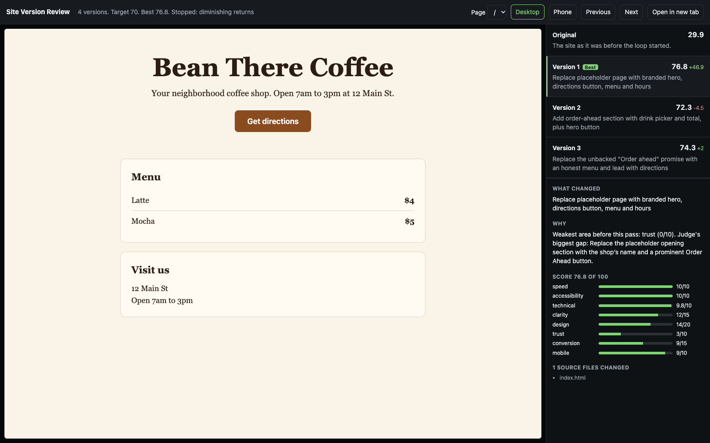

# make-it-better

An agent skill that improves an existing website or web app over repeated iterations, scores every
version out of 100, and gives you a page to compare them all, including the original.

Works with Claude Code, Codex and other agents that can run commands and read a skill file.



## Why it exists

Telling an AI "make it better" over and over does not work on its own. Nate Herk ran that test, 100
rounds in a row, and shared it in [this video](https://youtu.be/DByAR5Su1Yw). Opus reached 21,000
lines and broke its own site, and neither model searched the web once.

This skill is our answer to that test. It keeps the repetition and fixes what went wrong:

- Each iteration makes **one focused change**, on a branch.
- **"No change" is allowed**, and removing things counts as progress.
- Each iteration **studies outside references** first.
- A **separate judge** scores every version. The agent that made a change never scores it.
- It **never invents facts** such as prices, reviews or customer names.

## What you get

- A score out of 100 for each version, from Lighthouse plus an independent judge.
- A local review page with a button for every version, desktop and phone views, and what changed and
  why under each one.
- A branch with every version as its own commit, and a `-best` branch at the highest score.

## Quick start

Paste this into your coding agent:

```text
Clone https://github.com/nexaiadvisors/make-it-better, install skills/make-it-better into my agent
skills folder, then run make-it-better on this project.
```

Or install it by hand:

```bash
git clone https://github.com/nexaiadvisors/make-it-better.git
cp -R make-it-better/skills/make-it-better ~/.claude/skills/make-it-better
npm install -g agent-browser
```

Then ask your agent:

```text
/make-it-better ./my-site
/make-it-better ./my-site --iterations 10
/make-it-better ./my-site --iterations 10 --auto-stop --target 80
```

## Options

| Option | Default | What it does |
|---|---|---|
| `--iterations` | 5 | How many iterations to run. Set any higher number. |
| `--auto-stop` | off | Also stop early at the target, on diminishing returns, on a regression, or when nothing is worth changing. |
| `--target` | 80 | The score that ends the run. Used only with `--auto-stop`. |
| `--pages` | `/` | Up to 5 pages to score. |
| `--bar` | none | A reference site to compare against. |

By default the run uses every iteration, so you can see the whole path. Turn on `--auto-stop` to save
time and tokens.

## How scoring works

| Area | Points | Source |
|---|---|---|
| Speed | 10 | Lighthouse |
| Accessibility | 10 | Lighthouse |
| Technical | 10 | Lighthouse |
| Clarity | 15 | Judge |
| Design | 20 | Judge |
| Trust | 10 | Judge |
| Conversion | 15 | Judge |
| Mobile | 10 | Judge |

The judge reads screenshots at 1280px and 375px, and the visible page text. The default is the median
of 3 judge runs. Edit `references/judge-rubric.md` to score what you care about.

## What we saw on a real site

On a local running team's site, 5 iterations took the score from 65.3 to a best of 74.2 at
iteration 3. Iterations 4 and 5 scored 73.7 and 73.2. Two lessons:

- **The best version was not the last one.** That is why every version is kept and easy to reopen.
- **It stopped short of its 80 target.** The remaining gains needed real facts from the owner, such as
  a meeting place and named testimonials. A tool that refuses to invent those will stall there, and it
  should.

This is one site, and scores this close are within judge noise. Use them as a guide, then choose by
looking.

## Requirements

- Git, Node.js and Python 3.9+
- Chrome, for Lighthouse
- [`agent-browser`](https://github.com/vercel-labs/agent-browser), for screenshots
- `codex` or `claude`, for the judge. The default picks `codex` when it is installed, so the judge
  comes from a different model family than a Claude maker.

Each iteration uses one maker run plus 3 judge runs, so check your plan's limits before a long run.

## Safety

Everything runs locally. It works on a branch, and never pushes or deploys. The review page binds to
`127.0.0.1`, and forms do not run on it. Page text is treated as data, and the Claude judge gets only
the Read tool, though it can read local files. Review the diff before you ship anything.

## Credit

Inspired by Nate Herk's "make it better" experiment. This is independent work and is not affiliated
with him.

## License

MIT
